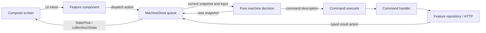

# How Weather uses Actron

[Back to the example](../README.md) · [Testing guide](../debugTools/src/commonTest/README.md)

Weather has two screens and five machine definitions. Read the search feature first; the weather
feature composes a screen parent with three independently executing child machines. Navigation is entirely Decompose's
responsibility. No third navigation machine is registered in Actron.

## Follow one input through the application



For search, the concrete chain is:

1. `CitySearchScreen` emits `CitySearchIntent.QueryChanged`.
2. `DefaultCitySearchComponent.onUiEvent` maps it to `CitySearchAction.ChangeQuery` and calls
   `store.dispatch`. It never assigns the feature state itself.
3. `MachineStore` processes the input sequentially against its current snapshot. The machine
   returns updated data, state transitions and descriptions of commands/timers to execute.
4. `citySearchHandler` runs `CitySearchRepository`, which calls `CitySearchRepository`.
   It returns `Found` or `Failed`; the result goes back through the machine's input queue.
5. `collectAsUiState` collects snapshots for Compose. `toUiState` formats the context for display.

The root supplies `Dispatchers.Main` for this example. Suspending HTTP belongs in a handler;
reducers and guards must remain quick and deterministic. Configuring a different processor does
not make synchronous blocking work in a reducer appropriate. See the library's
[threading contract](../../../doc/guides/machine-mvi.md) for dispatcher and UI-collection details.

## Define a machine once

Start with [CitySearchMachine.kt](../shared/src/commonMain/kotlin/actron/example/weather/feature/cities/presentation/CitySearchMachine.kt).

| Declaration | Meaning in Weather |
| --- | --- |
| `CitySearchState` | Sealed screen state. Each variant carries the query and revision |
| `CitySearchAction` | User edits and typed operation results |
| `SearchCitiesCommand` | Data describing a search to run; contains no HTTP implementation |
| `typedStateMachine` | Builds the search graph and its executable rules together |
| `state<T>` | Declares a graph node and its transitions |
| `on<Action> { guard; target }` | Declares one action edge; destination comes from target's return type |
| `always(transition = { ... })` | Chooses the next phase without another input |
| `after(delay = ..., transition = { ... })` | Declares an activation-owned debounce or timeout |
| `onEnter { command(...) }` | Registers work to execute after the decision commits |

The screen renders the current `CitySearchState` directly. Its variant selects the graph node.
`Success` carries the results and `Error` carries the cause. Saved sessions and recordings serialize the sealed state directly.
`MachineSnapshot` adds runtime configuration, revision and command/timer identities around the
context. The context's search `revision` identifies the query generation; it is distinct from
that runtime snapshot revision.

`DefinitionId` identifies a logical machine across its instances. `DefinitionVersion` is an
explicit compatibility contract for saved state/recordings. Bump it for incompatible behavioral
or data changes, including changes that do not alter the graph's visible structure. Region and
lane names are structural identifiers, not string keys for guards or effects.

### Search, cancellation and late answers

```text
Idle → ChangeQuery("Москва") → QueryChanged → always → Debouncing → after(350 ms) → Loading
Loading → ChangeQuery("Казань") → QueryChanged → always → Debouncing → after(350 ms) → Loading
Any search state → ChangeQuery(" ") → QueryChanged → always → Idle
```

`QueryChanged` tries the blank-query guard first, then an unconditional Debouncing fallback. The edit updates query/revision once.
The choice settles in the same decision: the history records both edges, and the UI receives
Idle or Debouncing. Each stable state declares its own `ChangeQuery → QueryChanged` edge.

The second edit updates the query/revision and exits the old `Loading` activation. Its command
and timeout are cancelled immediately, before the next debounce expires. Further edits restart
the debounce. Clearing enters `Idle`, with no pending search and no displayed results.

The new `Loading.onEnter` executes the request through the existing command handler.
`after(8.seconds)` declares the timeout edge; state exit cancels the timer and repository request. Timeout enters `Error(cause = RequestFailure.Timeout)`. Request failure uses the same Error state with an Unavailable cause; the UI offers the same retry action.
Cancellation propagates through the command handler to the suspending repository/HTTP call;
`commandHandler` rethrows cancellation instead of converting it into `Failed`.

Stale-command identity checks and the `Found`/`Failed` revision guards are an additional defense
for already queued results or callbacks outside normal command delivery. A test that deliberately
injects an old result does not mean Weather intentionally leaves obsolete requests running.

### Four independent weather machines

[CityWeatherMachine.kt](../shared/src/commonMain/kotlin/actron/example/weather/feature/weather/presentation/CityWeatherMachine.kt)
owns the city header and accepts only `WeatherScreenAction.Refresh`. Its Active entry emits one
`WeatherScreenEvent.RefreshChildren`, both on fresh Start and on the Refresh self-loop.
It has no child action imports, repository calls or loading state.

[WeatherMachines.kt](../shared/src/commonMain/kotlin/actron/example/weather/app/WeatherMachines.kt)
is the retained composition owner. It creates four MachineStores, attaches them to a MachineGroup,
registers three typed routes, starts the children and then starts the parent. Children enter Ready
without commands or timers before their own routed Refresh starts loading:

| Definition | Own public inputs | Work |
| --- | --- | --- |
| `city-weather` | WeatherScreenAction.Refresh | Emits RefreshChildren |
| `current-weather` | CurrentWeatherAction.Refresh / Loaded / Failed | LoadCurrentWeather |
| `hourly-forecast` | HourlyForecastAction.Refresh / Retry / Loaded / Failed | LoadHourlyForecast |
| `weather-advice` | WeatherAdviceAction.Refresh / Retry / Dismiss / Loaded / Failed | LoadWeatherAdvice |

The three routes map the same parent event to three different action types. The children know
neither the screen nor one another. Current and Hourly each have Ready/Loading/Success/Error;
Refresh works from all four states. Hourly also accepts its own Retry from each state.
Advice has Ready/Loading/Hidden/Visible/Dismissed/Error; Refresh works from all six. Dismiss
from Loading, Visible or Error cancels only its own work. Retry from Error reloads only Advice.
Cancelled command identities reject late answers; each machine also guards its selected city.

Advice calls the same WeatherRepository dependency as Current, but owns a separate request and
interprets the reading. Each global refresh makes two current-weather calls and one hourly call.
WMO precipitation codes follow [Open-Meteo](https://open-meteo.com/en/docs); wind >=40 km/h,
heat >=30°C and cold <=-10°C are demo thresholds. Labels and tips use native EN/RU XML resources.

A group route delivers `MachineInput.BridgeReceived` with the sender/effect MessageId. Each Store
has its own serialized queue, commands and timers: three deliveries are not one atomic decision.
UI combines immutable snapshots; `WeatherContext` is a derived view, not another mutable owner.
WeatherCheckpoints projects all four checkpoints plus in-flight delivery identities. Parent
observers mark committed routing intents before the group delivers them; child observers then
project the group's actual remaining messages. Frames with deliveries in flight cannot be
continued or saved as resumable checkpoints. This preserves per-member failure isolation without
pretending that group delivery is a distributed transaction.

## Components and lifetime

[WeatherRootComponent.kt](../shared/src/commonMain/kotlin/actron/example/weather/app/WeatherRootComponent.kt)
creates the Decompose stack and feature factories. Selection/back events travel through the
example's `ParentBridge`/`BridgeEndpoint` to the root; they are not Actron actions controlling
navigation. `BaseComponent.Render()` and `StackComponent` render the active child.

[MachineInstance.kt](../../../actron-decompose/src/commonMain/kotlin/actron/decompose/MachineInstance.kt)
owns the Store and its coroutine scope, starts it after construction and closes/cancels it on
destruction. It has no knowledge of Weather, recording, profiling or restoration.
[WeatherComponentFactories.kt](../shared/src/commonMain/kotlin/actron/example/weather/app/WeatherComponentFactories.kt)
uses [retainedMachine](../../../actron-decompose/src/commonMain/kotlin/actron/decompose/RetainedMachine.kt)
for search. Weather retains a WeatherMachines owner through its child InstanceKeeper; that owner
closes all four stores and its scope together when the weather child is popped. Recording is an optional, lazy configuration supplied by
[WeatherMachineRecording](../debugTools/src/commonMain/kotlin/actron/example/weather/app/debug/WeatherMachineRecording.kt).
The adapters bind it before startup and choose fresh creation or checkpoint resumption per machine. The search child
stays on the back stack while weather is open; popping weather destroys that weather executor.
A restored weather component does not dispatch a fresh `Refresh` over the restored state.

## Recording, preview and restoration

These are different representations with different capabilities:

| Representation | Contains | Used for |
| --- | --- | --- |
| `MachineSnapshot<C>` | Context and runtime configuration/identities | Current state and pure decisions |
| `ExecutorCheckpoint<C, CMD>` | Snapshot plus work/timing needed by the executor | Restarting pending operations |
| `WeatherFrame` | Search plus four weather checkpoints, route and in-flight delivery projection | Current application checkpoint and restoration |
| `WeatherHistoryFrame` | Application frame, frozen transition coverage | Live history preview and continuation |
| `WeatherRecordingFrame` | Display data, active nodes and coverage | Imported view-only history |

[WeatherHistory.kt](../debugTools/src/commonMain/kotlin/actron/example/weather/app/debug/WeatherHistory.kt)
attaches `DecisionTraceObserver` before the store starts. `BoundedMachineRecorder` retains the
machine trace; `HistoryTimeline` combines instances into a session-wide limit of 500 entries.
The host supplies field projections and a `WeatherHistoryFrame`; Actron does not interpret its route.

Selecting a history entry renders its saved data without running commands. Continuing from a
resumable live entry calls the root's `continueFrom`: it replaces the Decompose children and
recreates executors from their checkpoints. Pending read requests restart; completed reads stay
completed. Search v14 preserves the remaining debounce and request-timeout duration.
The other weather machines still restart their unfinished entry bodies and timeout on resume. This does not restore a suspended call stack or
guarantee exactly-once external side effects. Later history is removed after successful continuation.

[WeatherSavedState.kt](../shared/src/commonMain/kotlin/actron/example/weather/app/session/WeatherSavedState.kt)
declares `checkpointGroup` with one search checkpoint and zero or one weather checkpoints.
`machinePersistence` validates/serializes each machine. The host maps those checkpoints into its
frame and registers the encoded result with Essenty `StateKeeper`; Android supplies the saved
instance-state transport. Only the latest resumable frame is saved, not the debug timeline.

[WeatherRecording.kt](../debugTools/src/commonMain/kotlin/actron/example/weather/app/debug/WeatherRecording.kt)
uses `HistoryRecordingCodec` with the display schema and both graph definitions. Import checks
schema, machine versions and graph compatibility before displaying data. `HistoryRecordingPanel`
has no continuation path. Platform `HistoryFiles` adapters open/save bytes; the library has no
Android or Decompose dependency. File import never creates a feature component or HTTP command.

## Which Actron modules are involved?

| Module | Role here |
| --- | --- |
| `actron-statechart` | Machine DSL, decisions, queued Store, commands and timers |
| `actron-compose` | UI-safe collection of store snapshots |
| `actron-persistence` | Checkpoint persistence and resumption |
| `actron-timetravel` | Recording, bounded history and display codecs |
| `actron-decompose` | Retained machine setup and component-bound observation |
| `actron-timetravel-compose` | Reusable history/graph inspector and resizing |
| `actron-statechart-test` | Scripted executor tests, pure graph exploration and coverage |
| `actron-timetravel-test` | Optional test-trace export to view-only recordings |

Weather intentionally demonstrates debug tooling on every target. In a production app, isolate
debug modules in debug/test dependencies. The reusable library owns machine behavior; the host
owns navigation, lifecycle adapters, display projections and platform file access.


## Cohesion and the KMP Messenger comparison

This comparison uses the local `kmp_messenger_1` sources inspected on 2026-10-25:
`core/navigation` (`BaseComponent`, `StackComponent`, `Bridge`), Home's child bridges/factories,
and `ContactDetailFeatureGraph` under `feature/contact-detail/impl`.

| Boundary | KMP Messenger | Weather |
| --- | --- | --- |
| Navigation | Decompose components, parent-owned bridges, child factories | The same pattern for search and weather; root handles selection/back |
| Feature state | A feature owns its state and exposes a component contract | Each Actron Store is the only live feature-state writer; UI models are projections |
| Creation and lifetime | Factories/feature graphs assemble dependencies; lifecycle releases component work | App factories retain Store owners; components cancel only their own bridge scope |
| Diagnostics | Shell/tooling integrations sit outside feature contracts | Recording, preview and file adapters live in `debugTools`; current checkpoints and persistence live in `shared/app/session` |
| Dependency size | Multiple feature API/implementation modules and substantial feature graphs | One production module, an optional debug module and two feature factories; no DI framework |

The reusable `core` has no dependency on either feature or application composition. Feature
presentation does not depend on `WeatherHistory`, application recording types or the sibling
feature. Its component receives its Store and a bridge endpoint. The search toolbar receives
an explicit composable settings slot; the app shell owns settings visibility. There is no diagnostic
composition-local to discover from feature code.

App factories connect feature implementations to `WeatherSession` and an optional recording option:
that is the composition boundary. The debug root supplies recording and the settings action. Repository calls and their result/error mapping stay in each
feature's command handler. The former `SearchCitiesUseCase` only delegated to the repository
and added no policy, so it was removed. Introduce a use case if a distinct business rule or
cross-repository operation actually appears.

`WeatherSession` alone owns current checkpoints, route, branch and logical time. It has no Compose
hooks, recording option, coverage or profile fields. The ordinary root renders its feature stack.
`DebugWeatherRootComponent` wraps that root with settings and the inspector; `WeatherHistory`
receives the retained session through composition and owns only recording/diagnostic metadata.
Each immutable `WeatherHistoryFrame` pairs an application frame with frozen transition coverage.
Continuation restores those metadata before the ordinary root replaces its children. The fake
graph-error demonstration has been removed; the inspector displays the actual machine graph. Recording schema `actron.weather.display/3` uses the new app
package names; previous exported files are intentionally unsupported.

The scale trade-off is explicit: Messenger's separate feature graphs are useful with many
consumers and implementations; copying them into this two-screen example would add boundaries
without reducing current knowledge. Split the example's feature modules when they acquire
independent consumers or dependencies, rather than to reproduce the production module count.


## One-call machine installation

`actron-decompose` provides the machine installation API:

```kotlin
val store = componentContext.retainedMachine(
    key = "city-search",
    machine = CitySearchMachine.create(),
    initial = CitySearchState.Idle(),
    handler = citySearchHandler(repository),
)
```

No explicit scope, `getOrCreate`, `start` or close callback is needed. The default processor
is `Dispatchers.Main`; supply `coroutineContext` for a different owning dispatcher or tests.
A stable key identifies a Store for the lifetime of that `InstanceKeeper`. Recreating a component
with that key returns the original Store and does not replace its dependencies. Distinct business
instances require distinct keys (or, as in Weather, distinct child keepers).

Diagnostics and checkpoint continuation are independent options on the same call:

```kotlin
recording = history.recording()
// For the weather feature: recording = history.recording()
```

Each option is bound only when a new retained Store is created. Restoration supplies checkpoints,
clock and tracking; recording supplies history observers. The adapter attaches them before
startup, so the first decision is recorded. Recreating a host does not bind another recorder.
Handlers/options must not retain a component, bridge endpoint or UI-lifecycle scope.

Weather starts its children before its screen parent. A fresh parent emits RefreshChildren on
entry; resuming its already-started checkpoint skips entry hooks. No startup Refresh is dispatched
over restored children. Existing completed regions are not refreshed by
host recreation or continuation. Destroying the keeper closes the Store and cancels its commands.

A single `actron-decompose` module exposes the standard machine/Store integration. It depends
on core/statechart and Decompose, and has no time-travel, persistence-codec or Compose dependency.

## Declared search transitions and behavior handlers

Search v14 uses `typedStateMachine` with `guard / target` declarations. Its eleven
edges include actions, two automatic choices and two timers. The graph is available before
execution; rejected and accepted guards are recorded by the same engine that chooses transitions.
`target` infers the destination type from its factory, so Success is not written twice.
Each target carries the current query and revision into the next state. Only a query edit advances the revision.

This changes search continuation from v12: debounce and timeout retain their remaining delay,
and QueryChanged settles within the edit decision instead of publishing a separate entry result.
Definition version 14 serializes the full sealed state and rejects earlier city-search checkpoints.
HTTP remains restartable read work, not a saved coroutine stack. `CitySearchGraphTest` verifies
restoration, graph edges and both outcomes of response guards.

Other Weather features retain `behaviorStateMachine`, suspend `onEnter` and complete-snapshot
`target`. Those handlers support ordinary Kotlin control flow and use a conservative graph
envelope. Their unfinished entry work restarts from the beginning on continuation. Both APIs use
the same StateChart engine, immutable snapshots, command handling and queued Store.
